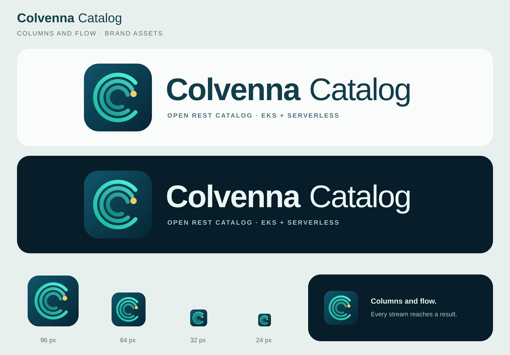

# Colvenna Catalog brand assets

The mark is the Colvenna series' own: three concentric teal flow lines form the "C" of Colvenna, and the innermost flows into a gold result point ("columns and flow": data that keeps moving reaches a query's result). Every product of the series uses the same mark and changes only the wordmark (a decision of the series, made in Colvenna for ClickHouse's issue 28); [`generate.py`](generate.py) renders it the way Colvenna Lake's brand generator does.

In the wordmark, "Colvenna" is bold, the main brand, and "Catalog" regular, the descriptor. The horizontal mark's second line is the tagline `OPEN REST CATALOG · EKS + SERVERLESS`, which names where the server runs (EKS) and no Apache project. The mark is drawn independently: it carries no Apache project name or logo, nor the ASF feather, as the [ASF trademark FAQ](https://www.apache.org/foundation/marks/faq/) asks of third-party products, and no official logo of Kubernetes or AWS. The public English descriptions (README, the repository's and the chart's) say Apache Paimon at their first mention.



| File | Use |
| --- | --- |
| [logo-light.svg](logo-light.svg) / [PNG](logo-light.png) | Horizontal mark on white or light backgrounds |
| [logo-dark.svg](logo-dark.svg) / [PNG](logo-dark.png) | Horizontal mark on dark backgrounds |
| [icon.svg](icon.svg) / [PNG](icon.png) | App icon, avatar and compact places |
| [brand-preview.svg](brand-preview.svg) / [PNG](brand-preview.png) | A self-contained preview: both marks, and the icon at 96, 64, 32 and 24 px |
| [generate.py](generate.py) | Writes every SVG above (and, with `--png`, the PNGs) |

## Colours and use

| Element | Colour |
| --- | --- |
| Tile | `#11556B` → `#062533` |
| Flow lines | `#1BB59E` → `#4FF2D6` |
| Result point | `#F5CB68` |
| Light mark: wordmark, tagline | `#123D4A`, `#52707A` |
| Dark mark: wordmark, tagline | `#EAF7F4`, `#A8C9C4` |

- Keep the original ratio, with clear space of at least an eighth of the icon's width around it.
- The horizontal mark is 660 × 160; show it at least 440 px wide (narrower, the tagline stops being legible; use the icon instead).
- Use the icon at 24 px or larger: at 24 px the C's flow lines still read, and the gold point, smaller, is still visible.
- The SVGs are self-contained and reference nothing outside themselves, `brand-preview.svg` included. The wordmark falls back through Arial, Helvetica and sans-serif, so its glyphs vary slightly with the viewer's fonts; the canvas leaves room past Arial's widths. The PNGs have transparent backgrounds, except the preview.

The brand assets are under the [Apache License 2.0](../../LICENSE).

> Apache, Apache Paimon, and Paimon are either registered trademarks or trademarks of The Apache Software Foundation in the United States and/or other countries. Colvenna Catalog is not affiliated with or endorsed by The Apache Software Foundation.

## Name and subtitle

The Colvenna series index (the series' `colvenna` repository) is the one source of every product's name, subtitle and description. This product:

- Name: **Colvenna Catalog**
- Subtitle: *REST catalog server for Apache Paimon* / Apache Paimon 的 REST 目录服务

The subtitle says what the product is and is no trademark; it names the Apache project in full, and the page it is on carries the ASF trademark attribution. Change the index first, then this repository.

The product was called Cove Catalog, with a cove-and-index icon, until the series took the name Colvenna (#26); its technical identifiers followed before v1.0 (#31).

## Regenerating

From the repository root:

```bash
python3 assets/brand/generate.py          # the SVGs only
python3 assets/brand/generate.py --png    # and the PNGs, with rsvg-convert
```

The PNGs' sizes are in `generate.py`'s `PNGS`: the horizontal marks 1320 × 320, the icon 512 × 512, the preview 1920 × 1340. `rsvg-convert` renders with the machine's fonts, so the machine rendering the PNGs needs a font metric-compatible with Arial (Arial, Arimo or Liberation Sans). Two runs on the same machine write the same bytes.
